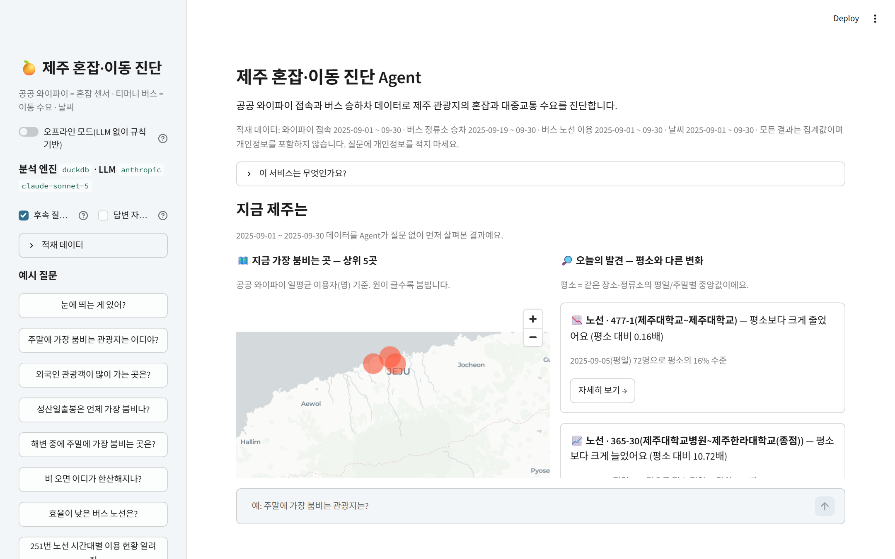
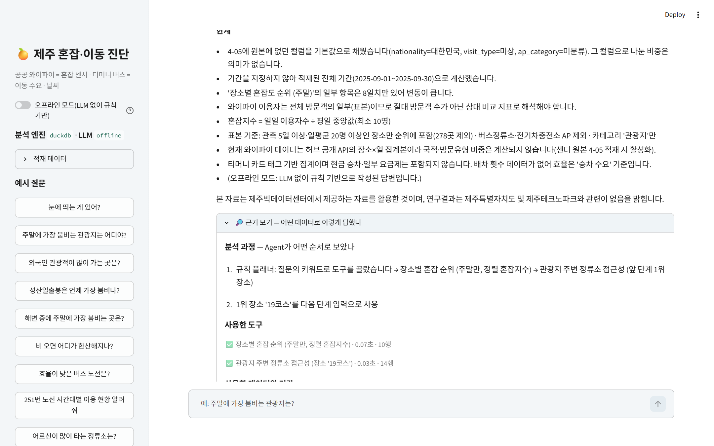
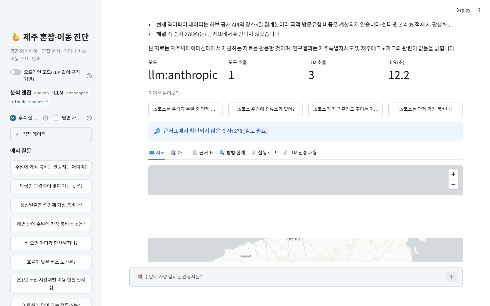
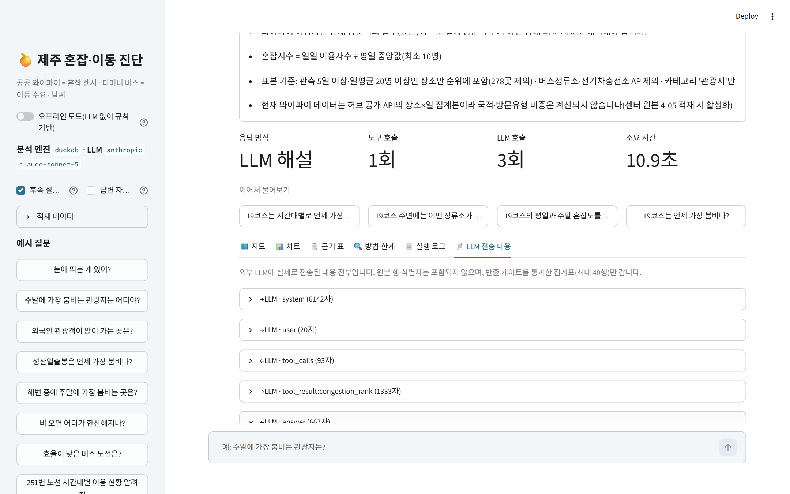

# 제주 혼잡·이동 진단 Agent

> 「제주 AI·빅데이터 활용 AI Agent 개발 챌린지」 출품작
> **공공 와이파이 접속 = 관광지 혼잡 센서**, **티머니 버스 승하차 = 이동 수요**, **일일 날씨**를 묶어
> 도민·공무원·관광객이 자연어 질문 한 줄로 *집계 → 지도·차트 → 쉬운 해설 → 근거·한계*를 얻는 AI Agent입니다.

```
"주말에 가장 붐비는 관광지는?"  →  혼잡 순위(지도) → 1위 관광지 주변 정류소 승차 수요 → 해설
"효율이 낮은 버스 노선은?"      →  노선별 승객/km/일 · 저이용 시간대 → 해설
"비 오면 어디가 한산해지나?"    →  강우일/비강우일 이용 변화율 순위 → 해설
(질문 전 첫 화면)              →  Agent가 먼저 훑은 혼잡 상위 5곳 지도 + 오늘의 발견 3건(급증·급감·최근 추세) → 카드 클릭으로 세부 분석
```

## 화면
<!-- screens:start -->




<!-- screens:end -->

## 왜 이 주제인가
- 2026년 제주는 **내국인 관광객 감소·외국인 급증**, **버스 준공영제 효율 논란**, **관광지 쏠림(오버투어리즘)**이 동시에 현안입니다.
- 유동인구·카드 데이터는 센터 밖 반출이 불가능하지만, **와이파이·버스·날씨 22종은 반출 가능**합니다. 이 서비스는 그 반출 가능 데이터만으로 혼잡과 이동을 진단하도록 설계되어 **누구나 집에서도, 센터 PC에서도 그대로 재현**할 수 있습니다.
- 와이파이 이용 데이터(4-05)에는 **국적·방문유형(관광/거주/업무)·AP 좌표**가 들어 있어, 유동인구 데이터 없이도 "어디에 관광객·외국인이 몰리는가"를 읽을 수 있는 거의 유일한 반출 가능 데이터입니다.

## 사용 데이터 (제주빅데이터센터 데이터 명세서 v12 기준, 모두 반출 가능)
| 코드 | 데이터명 | 역할 |
|---|---|---|
| **4-05** | 와이파이 AP별 이용 현황 | **필수** — 장소별 일일 고유 이용자, 국적·방문유형 → 혼잡지수 |
| 4-01 | 와이파이 AP 현황(고정형) | AP 위치·카테고리 |
| 4-06 | 와이파이 일별 이용자 현황 | 전체 추세 보조 |
| **3-04** | 버스 정류소별 이용 현황 | **필수** — 정류소 승차 수요, 교통약자 비중, 시간대 |
| 3-02 | 버스 노선별 이용 현황 | 노선 효율·저이용 시간대 |
| 3-01 / 3-03 | 버스 노선·정류소 정보 | 노선거리·정류소 좌표 |
| 5-02 / 5-01 | 일일 날씨·관측소 정보 | 강우 영향 |

자세한 활용 내역·전처리·이용조건은 [docs/DATA_SPEC.md](docs/DATA_SPEC.md), **실데이터를 받아 넣는 절차는 [docs/DATA_ACQUISITION.md](docs/DATA_ACQUISITION.md)** 참고.

> **데이터**: 저장소에 허브 공개 API 2025-09 축약본(`data/demo/*.csv.gz`, 2.5MB)이 동봉되어 있어 **설치 직후부터 실데이터로 동작**합니다. `data/raw/`에 파일을 넣으면 그쪽이 우선됩니다.
>
> **실데이터 경로 2가지** — 원본 4-05·3-04 CSV는 센터 분석실에서만 받을 수 있습니다("데이터검색" 메뉴는 분석실 전용). 집에서는 같은 제공처의 **허브 공개 API 6종**을 `python scripts/fetch_hub.py` 로 수집해 `data/raw/`에 넣으면 됩니다(2025년 최신, 10분). 국적·방문유형·시간대처럼 API에 없는 컬럼은 해당 기능만 비활성화되고, 센터 원본을 넣으면 자동 활성화됩니다. 넣은 뒤 `python scripts/check_data.py` 로 점검.
>
> **날씨(5-02·5-01)** 는 허브에 없어 `python scripts/fetch_weather.py` 로 받습니다 — 기상청 기상자료개방포털 CSV 변환(관측값, 권장) / Open-Meteo(키 없음) / 기상청 API허브. 2025-09 Open-Meteo 자료(4개 지점)는 `data/demo`에 동봉되어 강우 문항이 바로 동작합니다. 날씨가 없으면 강우 영향 기능만 비활성이며, 기간이 다른 합성 날씨는 실데이터에 섞지 않습니다.

## 제출 문서
- 기획서: [docs/AI_Agent_기획서_제주혼잡이동진단.pdf](docs/AI_Agent_기획서_제주혼잡이동진단.pdf) (원본 `docs/proposal.html`)
- 결과 설명자료: [docs/RESULT_REPORT.md](docs/RESULT_REPORT.md) · 사용자 매뉴얼: [docs/USER_MANUAL.md](docs/USER_MANUAL.md) · 데이터 활용 명세: [docs/DATA_SPEC.md](docs/DATA_SPEC.md)
- 샘플 실행 결과: `outputs/samples/` (**허브 공개 API 실데이터 2025-09**, 오프라인 모드 16문항 `batch_offline.json`, LLM 모드 `batch_llm.json`(키로 실행 시), 리포트 예시)
- 시연 대본·데모 배포·스크린샷: [docs/DEMO_SCRIPT.md](docs/DEMO_SCRIPT.md) · LLM 모드 검증표(11/7 Claude 실키 16문항): `docs/LLM_EVAL.md` (`python scripts/llm_smoke.py` 로 생성)

## 설치·실행 (5분)
Windows(센터 PC): `install.bat`(처음 한 번) → `run.bat`. macOS/Linux: `./install.sh` → `./run.sh`.
설치되는 패키지는 `requirements.txt`의 11개(pandas, numpy, pyyaml, python-dotenv, requests, matplotlib, duckdb, streamlit, plotly, pydeck, pytest)와 그 의존성이며, 고정 버전은 `requirements-lock.txt`.

```bash
# 수동 설치: Python 3.10+ 가상환경
python -m venv .venv && source .venv/bin/activate      # Windows: .venv\Scripts\activate
pip install -r requirements.txt

# 2) 데이터 넣기 — 둘 중 하나
#   a. 실데이터: 제주데이터허브에서 받은 CSV를 data/raw/ 에 그대로 복사 (파일명은 데이터명/코드/영문키 아무거나 인식)
#   b. 개발용 합성데이터: python -m jeju_agent.data.synthetic      (명세서 구조만 따른 가짜 데이터, 약 20초)

# 3) (선택) LLM 설정 — 없으면 오프라인 규칙 기반으로 동작
cp .env.example .env   # ANTHROPIC_API_KEY 또는 OPENAI_API_KEY 또는 로컬 Ollama(센터 PC: python scripts/ollama_check.py 로 점검)

# 4) 실행
streamlit run app.py                                    # 웹 UI
python -m jeju_agent.cli "주말에 가장 붐비는 관광지는?"     # CLI
python -m jeju_agent.cli --offline --batch examples/questions.txt   # LLM 없이 시연 질문 16개 일괄 실행
python -m jeju_agent.cli --status                        # 적재 데이터·LLM 상태 확인
python -m jeju_agent.cli --brief 2025-05                 # 월간 브리핑 HTML 저장
python -m jeju_agent.cli --offline --png "효율이 낮은 버스 노선은?"   # 차트를 PNG(반출용)로 저장
python scripts/fetch_hub.py --from 2025-08-01 --to 2025-09-30   # 허브 공개 API → data/raw (.env 에 JEJUHUB_PROJECT_KEY)
python scripts/check_data.py                             # data/raw 실데이터 인식·매핑·비활성 기능 점검
python scripts/fetch_weather.py --kma-csv OBS_ASOS_DD.csv  # 기상청 CSV → data/raw 날씨 (또는 --open-meteo --from 2025-09-01 --to 2025-09-30)
python scripts/ollama_check.py                           # 센터 PC 오프라인 LLM(Ollama) 서버·모델·도구호출 점검
python scripts/llm_smoke.py --limit 5                    # LLM 모드 실키 검증 (docs/LLM_EVAL.md 생성)
python scripts/validate_index.py                         # 혼잡지수 타당성 검증 → docs/VALIDATION.md (+ --visitors 입장객CSV)
python scripts/reproduce.py                              # 원클릭 재현: 동봉 축약본으로 18문항 실행 → 골든 지문 비교 → outputs/samples/ (--pytest 로 테스트까지)
pytest -q                                                # 테스트 84개 (API 키 불필요; 골든 회귀 20개는 동봉 축약본, 나머지는 합성 데이터로 격리 실행)
```

## 구조
```
질문 ─► 플래너 ──────────────► 도구 호출 ─► 반출 게이트 ─► 해설 ─► UI/리포트
        │ LLM(도구호출)            │ pandas/SQL 집계      │ 식별자 제거      │ LLM 또는
        └ 규칙 기반(오프라인 폴백)  └ 원본 행 접근 없음    │ <10 마스킹       └ 템플릿
                                                        └ 행 수 상한
```
| 모듈 | 역할 |
|---|---|
| `jeju_agent/data/loader.py` + `config/column_aliases.yaml` | CSV/XLSX 자동 인식(한글/영문 헤더, 별칭·기본값 규칙, 인코딩·구분자·날짜 포맷), DuckDB→sqlite 폴백, 파생 컬럼, 매핑 이력(provenance) |
| `jeju_agent/insight.py` | **자동 점검**(데이터 출처·기간·게이트·표본을 코드가 확인해 한계로 기록) · **이어서 물어보기**(결과 기반 후속 질문) · 실행 계획 문장 |
| `jeju_agent/llm_mock.py` | 시나리오 LLM — API 키 없이 LLM 모드 전체 경로를 테스트 |
| `jeju_agent/data/synthetic.py` | 명세서 스키마 그대로의 개발용 합성 데이터 |
| `jeju_agent/tools/` | 14개 분석 도구: `congestion_rank`, `place_profile`, `list_places`, `bus_station_rank`, `bus_route_efficiency`, `hourly_profile`, `place_access`, `weather_effect`, **`congestion_forecast`(주말 혼잡 예측)**, **`monthly_brief`(월간 브리핑)**, **`compare_periods`(전반/후반·평일/주말·두 기간 비교)**, **`explore_anomalies`(자율 탐색 — 질문 없이 급증·급감·최근 추세 발견)**, `run_sql`, `describe_data` |
| `jeju_agent/golden.py` + `tests/golden/` | **골든 회귀셋**: 18문항의 (도구 순서·행 수·첫 행 숫자·첫 사실) 지문을 동봉 축약본 기준으로 고정, `scripts/reproduce.py` 가 비교·갱신 |
| `jeju_agent/verify.py` | LLM 답변의 숫자가 근거표에 있는지 검증, 불일치 시 템플릿 해설로 대체 |
| `jeju_agent/charts.py` | PNG 차트(반출 정책: 그림파일만) — 리포트 내장·다운로드 |
| `jeju_agent/gate.py` + `config/export_rules.yaml` | 반출 게이트 |
| `jeju_agent/llm.py` | Anthropic / OpenAI / Ollama(네이티브 /api/chat, num_ctx 지정) 도구호출 (requests만 사용) |
| `jeju_agent/planner_rules.py` | LLM 없이 질문→도구 계획, 템플릿 답변 |
| `jeju_agent/agent.py` | 오케스트레이션, 로그, 폴백, **LLM 부가 단계**(답변-근거 대조 자기 점검 `review`, 결과 기반 후속 질문 `followups` — `LLM_EXTRAS`), **`discover()`**(첫 화면 자율 탐색: 혼잡 상위 5 + 오늘의 발견) |
| `jeju_agent/report.py` | 단일 HTML 리포트 |
| `app.py` | Streamlit UI (**첫 화면: 혼잡 상위 5곳 지도·오늘의 발견 카드·시작 질문** → 🧭 실행 계획·4단 답변·이어서 물어보기·지도·차트·근거표·방법/한계·실행 로그·**LLM 전송 내용 미리보기**·리포트/PNG 다운로드·올린 자료 삭제·대화 맥락) |
| `scripts/` | `fetch_hub.py`(허브 공개 API 수집) · `fetch_weather.py`(날씨 5-02·5-01 수집·변환) · `check_data.py`(실데이터 점검) · `ollama_check.py`(로컬 LLM 점검) · `llm_smoke.py`(LLM 검증표) · **`reproduce.py`(원클릭 재현·골든 비교)** · `capture_screens.py`(스크린샷) · `make_submission.py`(ZIP·PDF 생성) |

## 신뢰성 장치 (심사 포인트)
- **실행 계획 노출**: Agent가 어떤 데이터를 어떤 순서로 왜 봤는지(LLM 모드는 모델이 쓴 계획 문장, 오프라인은 규칙 선택 근거)를 답변 위 🧭 패널과 리포트에 남긴다.
- **자동 점검(한계)**: 데이터 출처(실데이터/합성/기본값 채움), 요청 기간과 적재 범위의 차이, 소집단 마스킹, 표본 일수, 숫자 검증 결과를 **코드가** 모아 모든 답변 끝에 붙인다. LLM이 한계를 빠뜨려도 결과물에는 항상 남는다.
- **LLM 전송 내용 미리보기**: 외부 LLM으로 나간 내용 전부를 탭에서 그대로 볼 수 있다. 원본 행·식별자는 없고 게이트 통과 집계표(≤40행)만 간다. 오프라인 모드는 전송 0건.
- **숫자 검증**: LLM 해설의 숫자가 근거표·facts에 없으면 메모를 남기고, 20% 넘게 어긋나면 템플릿 해설로 대체한다.
- **반출 게이트 = 센터 공식 기준**: 제주빅데이터센터 데이터 반출 정책(2026.09.01 개정)의 "단순집계 10 미만 불포함"에 맞춰 10 미만 셀 마스킹, 차트는 PNG로 반출.
- **출처 표기**: 이용약관 제7조 문구를 화면·리포트·모든 답변에 표시.
- **규정 근거 등급**: `docs/DATA_SPEC.md` §7에 [확인]/[확인 필요] 꼬리표로 적었다.
- **혼잡지수 타당성 검증**: `python scripts/validate_index.py` → `docs/VALIDATION.md`. 와이파이 이용자(4-05)와 같은 장소 반경 1km 버스 승차(3-04)를 대조해 방향·순위·요일 쏠림의 일치도를 범주별로 수치화하고, 어디까지 믿고 어디서부터 믿지 말아야 하는지(관광지·해변 ○, 도심 상권 △)를 적었다. 입장객 데이터가 있으면 `--visitors` 로 외부 검증 추가.
- **골든 회귀 + 원클릭 재현**: `python scripts/reproduce.py` 한 번으로 동봉 축약본 기준 18문항을 다시 돌려 `tests/golden/demo_golden.json` 의 지문(도구 순서·행 수·첫 행 숫자·첫 사실)과 대조한다. 코드가 바뀌어 결과가 달라지면 어느 문항의 어느 숫자가 달라졌는지 표로 보여 주며(`pytest` 에도 포함), 운영진의 코드 실행 요청(규칙 5조)에 같은 명령으로 답할 수 있다.

## Agent의 판단·자율 범위
- **질문 없이 먼저 움직임(자율 탐색)**: 첫 화면에서 Agent가 장소·정류소·노선의 일별 값을 평일/주말 중앙값과 비교해 급증(1.8배↑)·급감(0.55배↓)·최근 7일 추세(1.4배↑/0.7배↓)를 찾아 "오늘의 발견" 3건을 근거와 함께 보여 준다(`explore_anomalies`). 제공처 공백일·소표본은 제외하고, 발견 카드를 누르면 해당 장소·정류소·노선의 세부 분석 질문으로 이어진다. "눈에 띄는 게 있어?" 같은 열린 질문도 같은 도구로 답한다.
- **스스로 결정**: 어떤 도구를 몇 번 쓸지(최대 6회), 예측·브리핑·기간 비교처럼 여러 데이터를 묶을지, 장소·노선명 해석, 기간 기본값, 오류 시 인자 수정 재시도, LLM 장애 시 오프라인 폴백.
- **자기 점검·후속 제안(LLM 모드)**: 답변을 쓴 뒤 LLM이 자기 답변을 근거표와 대조해 과장·인과 표현을 지적하고(`review`, 자동 점검에 "LLM 자기 점검"으로 표시), 결과를 보고 다음 질문 3개를 제안합니다(`followups`). 둘 다 JSON 파싱 실패·장애 시 규칙 기반으로 대체되며 사이드바에서 끄고 켤 수 있습니다.
- **하지 않음**: 원본 행 열람, 식별자 컬럼 출력, 쓰기 SQL, 도구 결과에 없는 수치 생성(프롬프트로 금지 + 모든 수치가 로그에 남음).
- 답변은 항상 **한 줄 결론 / 근거 / 해석·제안 / 한계** 4단 구조이며, 합성 데이터 사용 시 경고를 강제합니다.
- **대화 맥락**: 최근 3턴을 함께 보내 "거기 가는 버스는?" 같은 후속 질문을 해석하며(오프라인 모드도 지시어 해석), 답변마다 결과에 맞춘 **이어서 물어보기** 3개를 제안합니다.
- **LLM 장애 대응**: 429/5xx·네트워크 오류는 지수 백오프로 재시도하고, 그래도 실패하면 같은 질문을 규칙 플래너로 처리해 답을 냅니다(계획 패널에 폴백 사실 표시).

## 센터 운영 PC(i7-8700 / GTX 1060 6GB / 32GB)에서
- 데이터 적재·분석은 CPU/메모리로 충분합니다(합성 80만 행 기준 적재 15초, 질문당 0.1~1초).
- 외부망이 있으면 Anthropic/OpenAI API, 없으면 **Ollama + qwen2.5:7b(4bit)** 로 로컬 실행 가능하며, 둘 다 없어도 오프라인 규칙 모드로 핵심 기능이 동작합니다.
- **오프라인 LLM 절차**: Ollama 설치 → `ollama pull qwen2.5:7b` → `python scripts/ollama_check.py`(서버·모델·도구 호출·Agent 질문 1개를 순서대로 점검) → `.env`에 `LLM_PROVIDER=ollama`. 시스템 프롬프트+도구 스키마가 약 8k 토큰이라 컨텍스트를 `OLLAMA_NUM_CTX=12288`(기본)로 보내고, 로컬 모델에는 컬럼 목록을 생략한 압축 프롬프트를 씁니다. 6GB VRAM에서 7b는 질문당 30~90초, 빠른 응답이 필요하면 `LLM_MODEL=qwen2.5:3b`.
- 외부 서비스 의존성: LLM API(선택) 외에는 없습니다. 지도는 pydeck 기본 타일(인터넷 필요) → 없으면 Streamlit 기본 지도로 폴백.

## 알려진 제약
- 와이파이 이용자는 방문객의 표본이며 AP 설치 수에 따라 편향됩니다 → **절대 방문객 수가 아닌 상대 지표**로만 해석.
- 4-05에는 시각 컬럼이 없어 와이파이 기준 '시간대별 혼잡'은 불가능합니다(시간대는 버스 데이터로 봄).
- 버스 효율은 배차 횟수가 없어 **승차 수요 기준**입니다. 현금 승차는 제외됩니다.
- 날씨 효과·기간 비교는 공휴일·행사를 통제하지 않은 단순 비교(상관)입니다. Open-Meteo 날씨는 재분석 격자값(관측소 실측 아님)이므로 가능하면 기상청 CSV를 쓰세요.
- 오프라인 모드는 정해진 질문 패턴만 이해합니다. 복합 질문은 LLM 모드를 권장합니다.
- 자율 탐색의 '발견'은 평소와 다르다는 신호일 뿐 원인(행사·날씨·공사·수집 오류)은 데이터에 없습니다. 관측값 10명 미만은 수집 공백 가능성을 표시하고 우선순위를 낮춥니다.

## 사용한 AI·오픈소스
- 개발 과정: Claude(Anthropic) 로 코드·문서 초안 작성 후 사람이 검토.
- 실행 시 LLM: Anthropic Claude / OpenAI GPT / Ollama(qwen2.5) 중 선택 (키는 .env, 저장소에 포함하지 않음).
- 오픈소스: pandas, numpy, DuckDB, Streamlit, Plotly, pydeck, PyYAML, python-dotenv, requests, pytest (모두 MIT/Apache/BSD).

## 라이선스·출처
데이터: 제주특별자치도·제주빅데이터센터·제주데이터허브(티머니, 농업기술원 등 원제공처). 결과물 소유권은 대회 규정에 따릅니다.
