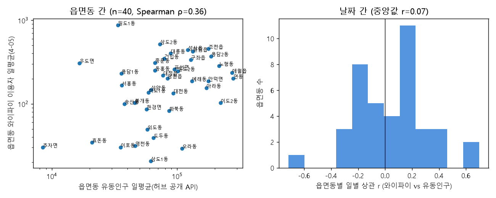

# 혼잡지수 타당성 검증

데이터: 와이파이 4-05 2025-09-01~2025-09-30, 버스 정류소 3-04 2025-09-19~2025-09-30 (동봉 축약본)

**검증 질문** — 이 서비스의 모든 혼잡 결과는 "공공 와이파이 접속자 수가 장소의 방문 규모를 따라간다"는 가정 위에 있다. 이 가정을 수집 주체·방식이 다른 독립 데이터로 확인한다.

## A1. 외부 기준 검증 — 읍면동 유동인구(허브 공개 API, 통신사 기반) vs 와이파이 이용자

- 데이터: 허브 「읍면동 단위 내국인 유동인구」 2025-09-01~2025-09-30 (30일), 와이파이 장소의 80%가 읍면동에 연결되어 **40개 읍면동** 비교
- **읍면동 간**: 유동인구 일평균 vs 와이파이 일평균 — Spearman ρ = **0.36**, log-log Pearson r = 0.37
- **날짜 간**: 읍면동별 일별 상관(10일 이상 40곳) — 중앙값 r = **0.07**, 양의 상관 21곳(52%)
- **주말 쏠림**: ±10% 넘게 치우친 37곳에서 방향 일치 **30%**
- **표본 비율**(와이파이 ÷ 유동인구): 중앙값 2.3‰, 읍면동 간 0.3~25.9‰ — 비율이 고르지 않으면 혼잡지수는 절대 규모가 아닌 '순위·방향' 지표로만 읽어야 한다

읍면동별 (유동인구 순):

| dong | population | wifi | n_places | days | wifi_per_mille | pop_weekend_ratio | wifi_weekend_ratio |
|---|---|---|---|---|---|---|---|
| 연동 | 280,023 | 200.70 | 9 | 30 | 0.70 | 1.10 | 0.80 |
| 애월읍 | 273,936 | 234.30 | 13 | 30 | 0.90 | 1.40 | 1.00 |
| 이도2동 | 221,108 | 102.60 | 16 | 30 | 0.50 | 1.10 | 0.80 |
| 노형동 | 214,785 | 283.90 | 18 | 30 | 1.30 | 1.10 | 0.80 |
| 용담2동 | 186,616 | 370.70 | 4 | 30 | 2.00 | 1.20 | 0.90 |
| 조천읍 | 177,607 | 454.50 | 24 | 30 | 2.60 | 1.40 | 1.00 |
| 안덕면 | 176,557 | 187.00 | 22 | 30 | 1.10 | 1.40 | 1.10 |
| 아라동 | 170,917 | 154.50 | 15 | 30 | 0.90 | 1.00 | 0.70 |
| 한림읍 | 133,274 | 421.40 | 25 | 30 | 3.20 | 1.40 | 0.80 |
| 예래동 | 130,806 | 186.90 | 9 | 30 | 1.40 | 1.30 | 1.00 |
| 구좌읍 | 127,996 | 337.50 | 29 | 30 | 2.60 | 1.50 | 1.00 |
| 성산읍 | 121,633 | 439.40 | 26 | 30 | 3.60 | 1.30 | 0.90 |
| 오라동 | 109,202 | 29.30 | 6 | 30 | 0.30 | 1.10 | 0.90 |
| 일도2동 | 100,802 | 246.30 | 9 | 30 | 2.40 | 1.20 | 0.90 |
| 표선면 | 94,658 | 258.30 | 21 | 30 | 2.70 | 1.30 | 0.90 |
| 대천동 | 93,119 | 133.90 | 11 | 30 | 1.40 | 1.10 | 1.10 |
| 대륜동 | 88,379 | 400.60 | 17 | 30 | 4.50 | 1.20 | 1.00 |
| 화북동 | 85,865 | 82.50 | 6 | 30 | 1.00 | 1.00 | 0.90 |
| 남원읍 | 83,466 | 202.10 | 14 | 30 | 2.40 | 1.30 | 1.10 |
| 건입동 | 78,748 | 346.70 | 9 | 30 | 4.40 | 1.10 | 1.00 |
| 대정읍 | 77,002 | 219.60 | 23 | 30 | 2.80 | 1.40 | 1.00 |
| 삼도2동 | 72,949 | 519.10 | 7 | 30 | 7.10 | 1.10 | 0.90 |
| 동홍동 | 66,592 | 249.60 | 16 | 30 | 3.80 | 1.20 | 0.80 |
| 중문동 | 66,424 | 310.60 | 18 | 30 | 4.70 | 1.30 | 1.00 |
| 도두동 | 64,755 | 39.30 | 4 | 30 | 0.60 | 1.20 | 0.90 |
| 삼양동 | 61,820 | 147.00 | 12 | 30 | 2.40 | 1.20 | 0.80 |
| 삼도1동 | 61,529 | 20.60 | 3 | 30 | 0.30 | 1.10 | 0.40 |
| 이도1동 | 58,770 | 136.30 | 4 | 30 | 2.30 | 1.00 | 0.90 |
| 외도동 | 57,794 | 49.40 | 4 | 30 | 0.80 | 1.30 | 1.00 |
| 한경면 | 57,020 | 86.20 | 19 | 30 | 1.50 | 1.50 | 0.90 |
| 영천동 | 46,128 | 31.50 | 7 | 30 | 0.70 | 1.20 | 0.90 |
| 봉개동 | 45,828 | 102.70 | 8 | 30 | 2.20 | 1.20 | 0.80 |
| 송산동 | 37,884 | 99.80 | 3 | 30 | 2.60 | 1.40 | 1.00 |
| 서홍동 | 36,028 | 165.80 | 10 | 30 | 4.60 | 1.00 | 1.00 |
| 용담1동 | 35,801 | 229.40 | 4 | 30 | 6.40 | 1.00 | 0.80 |
| 이호동 | 35,212 | 30.20 | 1 | 30 | 0.90 | 1.20 | 1.00 |
| 일도1동 | 33,589 | 870.10 | 13 | 30 | 25.90 | 1.20 | 1.10 |
| 효돈동 | 20,882 | 34.40 | 3 | 30 | 1.60 | 1.40 | 1.40 |
| 우도면 | 16,589 | 307.50 | 15 | 30 | 18.50 | 1.40 | 1.00 |
| 추자면 | 8,466 | 30.00 | 4 | 30 | 3.60 | 1.60 | 0.80 |

**관광 범주 AP 장소만으로 다시 계산** (관공서·도서관·주민센터 같은 평일형 공공시설 AP를 빼고 관광지·해변·시장·올레·공원 등만):

- 읍면동 39곳 · 읍면동 간 Spearman ρ = **0.25** (log-log r 0.29) · 일별 상관 중앙값 r = **0.09**, 양의 상관 59% · 주말 쏠림 방향 일치 **34%** (35곳)
- 표본 비율 중앙값 2.0‰ (0.1~25.6‰)

읽는 법: 통신사 '방문자수'는 그 읍면동에 거주·근무하지 않는 사람의 체류를 세므로 **도민의 주말 나들이까지 포함**해 거의 모든 읍면동에서 주말에 늘어난다(비율 1.1~1.6). 공공 와이파이는 관공서·도서관·공원 등 평일형 시설 AP가 많아 읍면동 전체로 합치면 주말에 줄어든다. 따라서 전체 AP 기준의 주말 쏠림 불일치는 측정 대상의 차이이지 모순이 아니다. 관광 범주 AP만으로도 격차가 줄지 않으면, 읍면동 단위 통신사 유동인구와 공공 와이파이는 '어디가 많은가'(장소 간 순위)만 느슨하게 공유하고 '언제 늘고 주는가'는 서로 다른 것을 재는 것으로 해석한다 → 날짜·요일 변화 결론은 와이파이 내부 기준선 대비 배수로만 말하고 외부 미검증임을 한계로 남긴다.

한계: 유동인구는 통신사 가입자 기반 추정치이고 와이파이는 AP가 있는 장소만 잰다. 법정동→행정동 변환표로 연결했으며 서귀동처럼 여러 행정동에 걸치는 법정동은 제외했다. 상관은 인과가 아니다.

## A2. 외부 기준 검증 — 관광지 입장객 (미수행)

허브의 관광지별 입장객·방문객 데이터(예: 관광지별 내국인 유입자 수)를 확보하면 `python scripts/validate_index.py --visitors FILE.csv` 로 이 절이 채워진다.

## B. 내부 교차 검증 — 같은 장소 반경 내 버스 승차(티머니) vs 와이파이 이용자

- 대상: 관광 범주(관광지·해변·시장·올레·숲길·공원 등) 장소 중 일평균 20명·관측 8일 이상(겹치는 기간 12일)이고 반경 1.0km 안에 정류소가 있는 **110곳**
- **B1 장소 간**: 기간 평균 와이파이 이용자 vs 반경 내 일평균 승차 — Spearman ρ = **0.26**, log-log Pearson r = 0.29
- **B2 날짜 간**: 장소별 일별 상관(8일 이상 110곳) — 중앙값 r = **0.19**, 양의 상관 72곳(65%), r ≥ 0.3 인 곳 37곳
- **B3 요일 패턴**: 주말/평일 비율의 전체 중앙값은 와이파이 0.99, 버스 0.76(버스는 통근 때문에 주말에 줄어듦). 그 중앙값 대비 ±15% 넘게 치우친 67곳에서 두 데이터의 쏠림 방향(주말형/평일형)이 일치한 비율 **72%**

범주별:

| 범주 | 장소 | B1 ρ | B2 r 중앙값 | B2 양의 상관 | B3 일치 |
|---|---|---|---|---|---|
| 공원 | 22 | 0.11 | 0.30 | 77% | 79% (14곳) |
| 관광지 | 20 | 0.42 | 0.11 | 70% | 65% (17곳) |
| 테마거리 | 19 | -0.11 | 0.09 | 53% | 80% (10곳) |
| 해변 | 19 | 0.28 | 0.22 | 63% | 82% (11곳) |
| 전통시장 | 13 | -0.14 | 0.27 | 92% | 100% (5곳) |
| 올레코스 | 13 | -0.13 | -0.15 | 31% | 33% (9곳) |
| 숲길 | 2 | - | 0.05 | 50% | - |
| 문화시설 | 2 | - | 0.35 | 100% | - |

읽는 법: B1이 높으면 '붐비는 장소 순위'가, B2가 높으면 '언제 붐비나(일별 추이)'가, B3가 높으면 '주말 쏠림' 결론이 독립 데이터로 뒷받침된다. 버스 승차는 통근·환승 통행을 포함하므로 완전한 기준은 아니며, 상관은 인과가 아니다.

장소 간 상위 20곳 (와이파이 일평균 순):

| ap_place | wifi_mean | bus_mean | n_stations | days |
|---|---|---|---|---|
| 제주동문시장 | 371.70 | 6,156 | 55 | 12 |
| 서귀포매일올레시장 | 277.00 | 4,788 | 79 | 12 |
| 탑동 테마거리 | 202.80 | 4,272 | 31 | 12 |
| 아랑조을거리 | 177.50 | 4,637 | 74 | 12 |
| 문화의 거리 | 167.60 | 5,709 | 53 | 11 |
| 칠성로 쇼핑거리 | 166.20 | 5,789 | 52 | 12 |
| 고마로 거리 | 126.10 | 3,362 | 57 | 12 |
| 서문가구거리 | 119.60 | 5,084 | 59 | 12 |
| 협재 해변(협재해수욕장) | 109.00 | 379.20 | 9 | 12 |
| 함덕 서우봉 해변 #1 | 107.60 | 1,144 | 20 | 12 |
| 성산일출봉 | 107.00 | 343.50 | 9 | 12 |
| 함덕 서우봉 해변 | 96.80 | 957.90 | 17 | 12 |
| 한담해변 | 96.10 | 505.40 | 10 | 12 |
| 솔동산 문화의 거리 | 93.10 | 2,252 | 54 | 12 |
| 6코스 | 92.50 | 129.00 | 21 | 12 |
| 칠십리 음식 특화거리 | 86.00 | 2,278 | 53 | 12 |
| 문화근린공원 | 82.40 | 1,986 | 54 | 12 |
| 중문관광단지 | 76.20 | 405.70 | 23 | 12 |
| 국수문화거리 | 76.20 | 9,551 | 56 | 12 |
| 이중섭거리 | 75.50 | 4,324 | 69 | 12 |

장소별 일별 상관 상위·하위 5곳:

| ap_place | days | r | rho |
|---|---|---|---|
| 서문가구거리 | 12 | 0.74 | 0.84 |
| 형제해안도로 | 11 | 0.72 | 0.67 |
| 섭지코지 | 11 | 0.68 | 0.71 |
| 노형근린공원 | 12 | 0.61 | 0.79 |
| 월정해수욕장 샤워탈의장 | 8 | 0.59 | 0.74 |
| 5코스 | 12 | -0.73 | -0.47 |
| 사라봉공원 | 12 | -0.62 | -0.57 |
| 20코스 | 12 | -0.57 | -0.65 |
| 세화공원 | 12 | -0.51 | -0.47 |
| 표선 해비치 해변 | 12 | -0.50 | -0.53 |

## 결론·한계

- **요약(내부 교차)**: 장소의 65%에서 와이파이와 인근 버스 승차가 같은 방향으로 움직이고(일별 상관 중앙값 0.19), 요일 쏠림 방향은 72% 일치한다. 장소 간 순위는 관광지(ρ 0.42)에서 ρ 0.3대로 따라가지만(표본 20곳 안팎이라 확정적이지 않음) 전통시장·테마거리·올레코스처럼 도심 상권·통근 동선과 겹치는 범주에서는 약하다(버스 승차가 통근을 포함). → 혼잡지수는 '방향·순위' 수준의 상대 지표로 쓰고, 절대 규모나 도심 상권의 세밀한 순위에는 쓰지 않는다는 서비스의 해석 원칙을 데이터가 뒷받침한다.
- 검증은 '와이파이 이용자 = 방문객 수'가 아니라 **'와이파이 이용자가 방문 규모와 같은 방향으로 움직인다'**를 확인하는 것이다. 서비스의 모든 답변은 절대 방문객 수가 아닌 상대 지표(혼잡지수 = 평소 평일 대비 배수)로만 결과를 말한다.
- 와이파이 표본은 AP 수·설치 위치·실내외·이용자 연령(젊은 층 과대)에 따라 편향될 수 있다. 외부 기준(입장객)이 있는 장소에서 표본 비율(와이파이 ÷ 입장객)이 장소마다 다르면 장소 간 비교는 '순위' 수준으로만 해석해야 한다.
- 이 문서는 `python scripts/validate_index.py` 로 재생성된다(데이터가 바뀌면 숫자도 바뀜).
