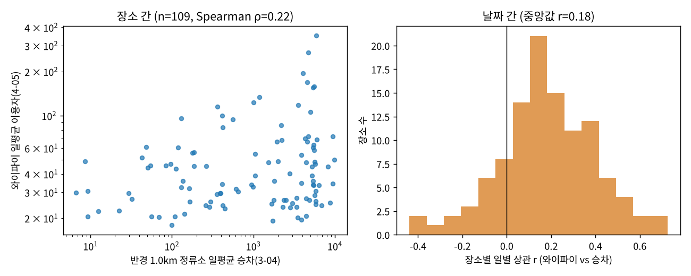

# 혼잡지수 타당성 검증

데이터: 와이파이 4-05 2025-09-01~2025-09-30, 버스 정류소 3-04 2025-09-01~2025-09-18 (동봉 축약본)

**검증 질문** — 이 서비스의 모든 혼잡 결과는 "공공 와이파이 접속자 수가 장소의 방문 규모를 따라간다"는 가정 위에 있다. 이 가정을 수집 주체·방식이 다른 독립 데이터로 확인한다.

## A1. 외부 기준 검증 — 읍면동 유동인구 (미수행)

허브 공개 API「읍면동 단위 내국인 유동인구」를 `python scripts/fetch_hub.py --only dong_population` 으로 받아 `data/raw/dong_population/` 에 넣으면 이 절이 자동으로 채워진다(또는 `--dong-pop FILE.csv`).

## A2. 외부 기준 검증 — 관광지 입장객 (미수행)

허브의 관광지별 입장객·방문객 데이터(예: 관광지별 내국인 유입자 수)를 확보하면 `python scripts/validate_index.py --visitors FILE.csv` 로 이 절이 채워진다.

## B. 내부 교차 검증 — 같은 장소 반경 내 버스 승차(티머니) vs 와이파이 이용자

- 대상: 관광 범주(관광지·해변·시장·올레·숲길·공원 등) 장소 중 일평균 20명·관측 12일 이상(겹치는 기간 18일)이고 반경 1.0km 안에 정류소가 있는 **109곳**
- **B1 장소 간**: 기간 평균 와이파이 이용자 vs 반경 내 일평균 승차 — Spearman ρ = **0.22**, log-log Pearson r = 0.24
- **B2 날짜 간**: 장소별 일별 상관(12일 이상 109곳) — 중앙값 r = **0.18**, 양의 상관 87곳(80%), r ≥ 0.3 인 곳 32곳
- **B3 요일 패턴**: 주말/평일 비율의 전체 중앙값은 와이파이 1.01, 버스 0.82(버스는 통근 때문에 주말에 줄어듦). 그 중앙값 대비 ±15% 넘게 치우친 60곳에서 두 데이터의 쏠림 방향(주말형/평일형)이 일치한 비율 **65%**

범주별:

| 범주 | 장소 | B1 ρ | B2 r 중앙값 | B2 양의 상관 | B3 일치 |
|---|---|---|---|---|---|
| 공원 | 22 | 0.09 | 0.27 | 86% | 92% (13곳) |
| 관광지 | 20 | 0.40 | 0.21 | 85% | 60% (15곳) |
| 테마거리 | 19 | -0.10 | 0.16 | 79% | 60% (5곳) |
| 해변 | 19 | 0.34 | 0.20 | 79% | 80% (10곳) |
| 전통시장 | 13 | -0.03 | 0.11 | 77% | 67% (9곳) |
| 올레코스 | 12 | 0.11 | 0.13 | 58% | 0% (6곳) |
| 숲길 | 2 | - | 0.40 | 100% | - |
| 문화시설 | 2 | - | 0.34 | 100% | - |

읽는 법: B1이 높으면 '붐비는 장소 순위'가, B2가 높으면 '언제 붐비나(일별 추이)'가, B3가 높으면 '주말 쏠림' 결론이 독립 데이터로 뒷받침된다. 버스 승차는 통근·환승 통행을 포함하므로 완전한 기준은 아니며, 상관은 인과가 아니다.

장소 간 상위 20곳 (와이파이 일평균 순):

| ap_place | wifi_mean | bus_mean | n_stations | days |
|---|---|---|---|---|
| 제주동문시장 | 350.30 | 5,938 | 55 | 18 |
| 서귀포매일올레시장 | 268.10 | 4,754 | 79 | 18 |
| 탑동 테마거리 | 194.20 | 4,071 | 31 | 18 |
| 아랑조을거리 | 169.10 | 4,609 | 74 | 18 |
| 칠성로 쇼핑거리 | 158.30 | 5,581 | 52 | 18 |
| 문화의 거리 | 155.70 | 5,445 | 53 | 18 |
| 함덕 서우봉 해변 #1 | 133.10 | 1,186 | 20 | 18 |
| 함덕 서우봉 해변 | 123.30 | 1,000 | 17 | 18 |
| 고마로 거리 | 117.50 | 3,535 | 57 | 18 |
| 성산일출봉 | 114.70 | 360.20 | 9 | 18 |
| 서문가구거리 | 105.40 | 5,020 | 59 | 18 |
| 협재 해변(협재해수욕장) | 100.00 | 415.90 | 9 | 18 |
| 6코스 | 95.70 | 130.30 | 21 | 18 |
| 한담해변 | 93.80 | 563.40 | 10 | 18 |
| 솔동산 문화의 거리 | 85.80 | 2,200 | 54 | 18 |
| 중문관광단지 | 83.20 | 418.20 | 23 | 18 |
| 국수문화거리 | 72.40 | 9,445 | 56 | 18 |
| 산지천거리 | 72.40 | 4,751 | 49 | 18 |
| 이중섭거리 | 69.50 | 4,290 | 69 | 18 |
| 제주서문시장 | 68.40 | 5,969 | 57 | 18 |

장소별 일별 상관 상위·하위 5곳:

| ap_place | days | r | rho |
|---|---|---|---|
| 노형제1근린공원 | 18 | 0.73 | 0.72 |
| 한라산국립공원_성판악탐방안내소 | 18 | 0.66 | 0.54 |
| 중문관광단지 | 18 | 0.62 | 0.83 |
| 19코스 | 18 | 0.57 | 0.61 |
| 산방산 | 18 | 0.57 | 0.34 |
| 아쿠아플라넷 | 18 | -0.44 | -0.47 |
| 칠십리 음식 특화거리 | 18 | -0.37 | -0.30 |
| 협재 해변(협재해수욕장) | 18 | -0.29 | -0.04 |
| 칠십리공원 | 18 | -0.28 | -0.24 |
| 일도이동 그린쉼터 | 18 | -0.27 | -0.15 |

## 결론·한계

- **요약(내부 교차)**: 장소의 80%에서 와이파이와 인근 버스 승차가 같은 방향으로 움직이고(일별 상관 중앙값 0.18), 요일 쏠림 방향은 65% 일치한다. 장소 간 순위는 관광지·해변(ρ 0.4, 0.34)에서 ρ 0.3대로 따라가지만(표본 20곳 안팎이라 확정적이지 않음) 전통시장·테마거리·올레코스처럼 도심 상권·통근 동선과 겹치는 범주에서는 약하다(버스 승차가 통근을 포함). → 혼잡지수는 '방향·순위' 수준의 상대 지표로 쓰고, 절대 규모나 도심 상권의 세밀한 순위에는 쓰지 않는다는 서비스의 해석 원칙을 데이터가 뒷받침한다.
- 검증은 '와이파이 이용자 = 방문객 수'가 아니라 **'와이파이 이용자가 방문 규모와 같은 방향으로 움직인다'**를 확인하는 것이다. 서비스의 모든 답변은 절대 방문객 수가 아닌 상대 지표(혼잡지수 = 평소 평일 대비 배수)로만 결과를 말한다.
- 와이파이 표본은 AP 수·설치 위치·실내외·이용자 연령(젊은 층 과대)에 따라 편향될 수 있다. 외부 기준(입장객)이 있는 장소에서 표본 비율(와이파이 ÷ 입장객)이 장소마다 다르면 장소 간 비교는 '순위' 수준으로만 해석해야 한다.
- 이 문서는 `python scripts/validate_index.py` 로 재생성된다(데이터가 바뀌면 숫자도 바뀜).
